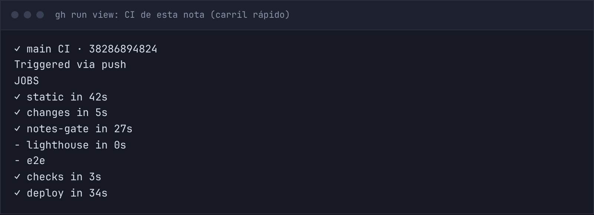

## Publicar una nota era más trabajo que escribirla

Cada nota de este sitio es un archivo MDX dentro del repositorio. Eso tiene ventajas que no quiero perder: está en git, se revisa como código y el build rechaza un frontmatter roto. La desventaja es que publicar una nota es lo mismo que publicar cualquier cambio: un release a `main`.

Y un release a `main` corre todo. Las comprobaciones estáticas, las pruebas e2e repartidas en cuatro runners, Lighthouse en dos, el build white-label y, si todo pasa, el deploy. En la nota anterior medí ese CI completo en unos 221 segundos. Para añadir un texto, cada vez.

Alrededor del CI había además nueve pasos a mano: mover la carpeta fuera de `drafts/`, poner la fecha, escribir la entrada del changelog, compilar, hacer el commit, empujar `develop`, armar el commit de release, empujar `main` y vigilar el run. Ninguno es difícil. Juntos eran la razón por la que publicar se sentía como una tarea y no como el final de escribir.

## Dos problemas, no uno

Mi primera reacción fue tratarlo como un solo problema: "publicar es lento". Al mirar el flujo vi que eran dos, y que se resuelven con cosas distintas:

- **Los pasos manuales** no necesitan CI ni infraestructura. Necesitan un script.
- **La espera** viene de que el CI no distingue entre un texto y código. Necesita saber qué cambió.

Descarté tres caminos:

- **Un CMS o guardar las notas en una base de datos.** Perdería git, MDX y la validación del build, a cambio de resolver un problema que no necesita tanto.
- **Editar desde la web de GitHub o el móvil.** Sigo pasando por el CI completo, así que no toca lo que me molestaba.
- **Programar la publicación por fecha.** Es útil, pero es otra cosa: no hace más corto el camino de hoy.

## Un comando

```txt title="qué hace pnpm publish-note"
borrador en drafts/<slug>
   → lo mueve a notes/<slug> y pone la fecha de hoy
   → añade la entrada del changelog
   → build + presupuestos de tamaño   (si algo falla, el borrador vuelve a drafts/)
   → commit y auditoría del changelog
   → push de develop y release a main
```

Ejecutarlo es mi autorización para empujar a `main`: ese permiso lo doy yo, no el script por su cuenta. Con `--dry-run` imprime los pasos sin cambiar nada, y con `--no-release` se detiene tras el commit local. Así se ve el ensayo con esta misma nota:


La lógica que se puede probar (reescribir `pubDate`, construir la entrada del changelog, armar el mensaje de release) vive en un módulo puro con diez pruebas. El script en sí es una capa fina que llama a `git` y a `pnpm`.

Hubo una decisión pequeña, de costo y beneficio. Pensé en correr también los dos presupuestos de tamaño (JavaScript y peso de página) dentro del comando. Pregunté si eso añadía tiempo y lo medí en el archivo de tiempos del repo: cada uno tarda menos de cinco segundos. A cambio, una nota demasiado pesada falla en mi máquina y no después de haber empujado a `main`. Los dejé dentro.

## Un carril rápido

El CI ahora empieza por un job que pregunta qué archivos trae el push.

```txt title="qué decide el CI al recibir el push"
¿todos los archivos están en content/notes/
 o son changelog.json / releases.json?
   │
   ├─ sí → static + build y presupuestos de tamaño + deploy
   │
   └─ no, o no se puede saber → todo: static, e2e, Lighthouse,
                                 white-label + deploy
```

En el carril rápido sigue el build, que es lo que rechaza un frontmatter inválido o una traducción huérfana, siguen los presupuestos de peso, y el deploy conserva su comprobación de humo y su rollback. Lo que se salta es lo que mide el navegador: e2e y Lighthouse. Un push que mezcla una nota con cualquier otro archivo usa el CI completo, así que el carril no puede esconder un cambio de código.

Es un recorte con un costo que prefiero nombrar: si una nota usa un diseño raro, el carril rápido no lo ve en un navegador. Por eso la guía sigue diciendo que se mire la nota en el servidor de desarrollo antes de publicar.

## Tres cosas que salieron mal por el camino

**El hueco del "saltado cuenta como aprobado".** El job que agrupa los resultados, `checks`, trata un job saltado como un pase, y eso es lo que permite que el carril rápido pase sin e2e. Pero significa también que, si el job que detecta el tipo de push fallaba, los demás quedaban saltados y `checks` pasaba sin haber corrido nada. Lo cerré incluyendo ese job en la lista que `checks` vigila, para que su fallo cuente como fallo.

**Una prueba que mentía.** Probé la regla de rutas con casos de ejemplo, y uno que debía ser "todo el CI" (una nota más un archivo CSS) salió como "carril rápido". Era grave si fuera real. No lo era: en mi terminal `grep` es una función que apunta a `rg`, donde la opción `-E` significa otra cosa. La regla estaba bien; el que fallaba era mi forma de probarla. Repetí los seis casos con el `grep` real y dieron lo esperado.

**Una auditoría por commit.** La auditoría del changelog exige que la entrada viaje en el mismo commit que cada cambio de tipo `feat`. Había dejado la entrada para el final y la auditoría lo notó. Como los commits no se habían empujado todavía, integré la entrada al commit correspondiente.

## El primer run, con el CI completo

El run de CI que desplegó este cambio usó el CI completo, porque tocaba el propio workflow. Así quedó, con `changes` resuelto en 3 segundos y `notes-gate` saltado, que es lo correcto cuando el push no es solo de notas:


Ese run tampoco salió limpio a la primera. Lighthouse falló en `/me/`: una de sus tres corridas midió un salto de layout de 0,31 (el límite es 0,1) y las otras dos, prácticamente cero. El release no tocaba ninguna página, así que repetí solo el job fallido y pasó todo. En la repetición, el camino más largo fueron los 4 min 13 s de Lighthouse más 42 s de deploy. No sé todavía si es un salto real e intermitente de esa página; lo dejé como un issue del repositorio para investigarlo. De paso, es una buena razón para el carril rápido: publicar una nota no debería depender de esa lotería.

## La primera publicación se detuvo sola

Con todo eso en producción, intenté publicar esta nota con el comando. No llegó a empujar nada: el comando devolvió el borrador a `drafts/` y se detuvo. No fue por la nota. Falló la página del tema *Rendimiento y verificación*, que superó su límite de HTML por 718 bytes porque la nota entra en ese tema por sus etiquetas.

El límite de esas páginas era un número fijo, mientras que el del índice de notas ya crecía con cada nota. Era el mismo defecto que ya había parchado para el índice, ahora en otra página. Subir otro número habría funcionado, y habría vuelto a pasar con la siguiente nota. En lugar de eso cambié la regla:

- Las páginas de tema tienen un margen fijo más 800 bytes por cada nota que listan, bajo un techo absoluto que obliga a paginar.
- Cada tipo de página tiene que declararse como fijo o como creciente con el contenido, y un test lo exige. Si añado un tipo nuevo sin decidirlo, falla.
- El chequeo de tamaño imprime cuántas notas más caben. Con esta nota ya publicada: el índice aguanta unas 14 más antes de necesitar paginación, y cada tema unas 43.

Lo que protege el rendimiento sigue estricto: el CSS y la estructura fija de la página no se relajaron.

## Lo que medí al publicarla

Esta nota fue el primer push que solo tocaba notas.



- **El comando:** 15 segundos desde que lo ejecuté hasta el push, con el build y los dos presupuestos de tamaño incluidos.
- **El CI:** 89 segundos de principio a fin. El CI completo del release anterior tardó 325 segundos, así que son 73 % menos. Es una sola muestra de cada tipo y ambas cuentan la espera para arrancar los runners, así que tómalo como orden de magnitud.
- **En producción:** la nota, su tarjeta de compartir y las imágenes (optimizadas a WebP en el build) respondieron bien, y `version.txt` coincidía con el commit.

## Qué sigue sin resolver

Dos cosas. La intermitencia de `/me/` sigue sin causa conocida: está en el issue y no la voy a esconder detrás de un reintento. Y todavía no tengo una política para las mediciones ruidosas del CI (Lighthouse, accesibilidad): hoy un fallo aislado bloquea el release y lo repito yo a mano. La idea es un reintento automático que deje el fallo anotado en el resumen del run, para que no se esconda.
