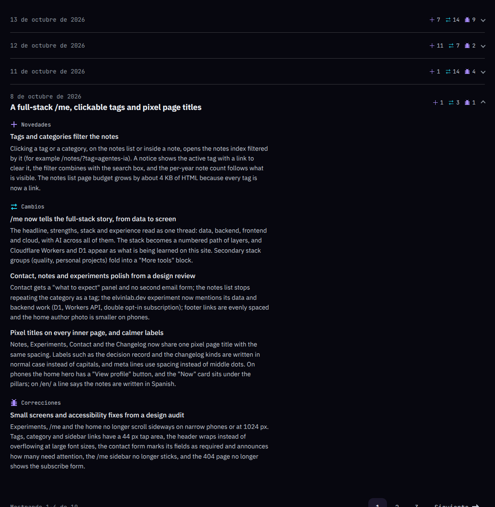
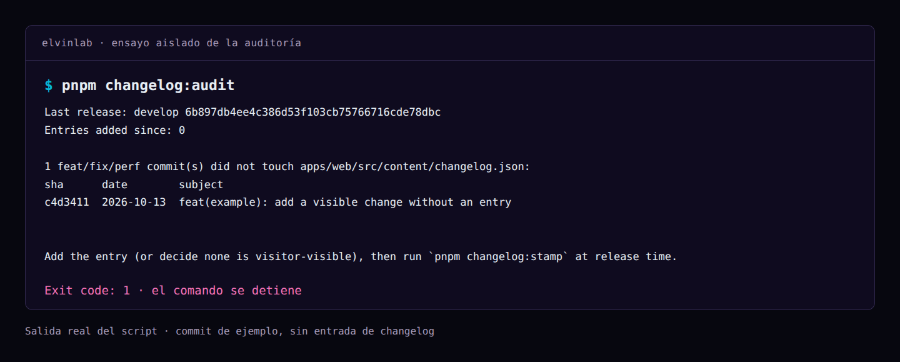

import Fix from '@/features/notes/components/Fix.astro';
import Ink from '@/shared/ui/Ink.astro';

## 83 entradas en seis días y una lista que ya no se podía recorrer

Al revisar el changelog el 7 de octubre, había **83 entradas en seis días** y la página rondaba los **130 KB**. Son las cifras que quedaron en la enmienda del ADR, no el tamaño actual del historial.

La primera versión, la del ADR 0010, era una lista plana con fechas. Funcionó mientras el historial cabía en una pantalla; después creció más rápido de lo que la página podía mostrar con comodidad.

Lo que quería era sencillo: que alguien abriera el historial y entendiera qué había cambiado desde su última visita, sin recorrer los commits. Este sitio se despliega continuamente, y puedo publicar una funcionalidad y corregirla el mismo día.

## Por qué un día de producción y no una versión ni un despliegue

Usar versiones semánticas me añadía una decisión que aquí aportaba poco: qué cambio merece subir qué número. No publico un paquete que otros proyectos instalan en una versión concreta; registro cambios de una web. Si más adelante extraigo una librería que otros consuman, el versionado tendrá otro propósito, comunicar compatibilidad, y esta decisión tiene el alcance del sitio.

La alternativa más cercana era agrupar por despliegue. El historial de `main` mostraba unos **22 despliegues de producción en cuatro días**, con seis el 1 de octubre y otros seis el 6. Eso habría dejado unos 22 bloques de una a cuatro entradas: cambiaba la forma de la lista, pero seguía habiendo muchos bloques pequeños.

Me quedé con una unidad que las entradas ya tenían: [un release es un día de producción](https://github.com/elvinlab/elvinlab.dev/blob/main/docs/adr/0010-visitor-changelog-no-semver-single-language.md). Si trabajé en algo el lunes y lo publiqué el jueves, la entrada lleva la fecha del jueves, que es desde cuando alguien pudo usarlo. Si publico tres veces en un día, los cambios quedan juntos. No tuve que migrar las entradas ni inventar una numeración de releases.



*Captura local con el contenido del repositorio. Los bloques representan días, no despliegues.*

Dentro de cada día, las categorías conservan un orden fijo: novedades, cambios, correcciones, retiradas, seguridad y obsolescencias. Dentro de cada categoría, las entradas se ordenan por título, así que el orden del archivo no cambia la presentación.

La paginación cuenta **días, no entradas**: cuatro por página, por defecto. Los dos más recientes de la primera página empiezan abiertos y el resto queda plegado con `details` nativo. Funciona sin JavaScript y el contenido sigue en el HTML aunque el bloque esté cerrado. Las páginas anteriores tienen URL propia y aparecen en el sitemap.

## La explicación la escribo a mano

Las entradas viven en `changelog.json`, dentro de `apps/web/src/content/`. Esta es una real, la que anunció la primera versión de la página:

```json title="changelog.json · la entrada original" {3,4}
{
  "changelog-page": {
    "date": "2026-10-01",
    "category": "added",
    "title": "Changelog page",
    "description": "This very log: a place to see visible site changes as they ship."
  }
}
```

La clave identifica el cambio, la fecha dice cuándo salió y el título y la descripción explican qué pasó. Las categorías son las de Keep a Changelog: `added`, `changed`, `fixed`, `removed`, `security` y `deprecated`. Una mejora de rendimiento va en `changed`; no añadí una categoría por cada tipo de commit. Cuando un día necesita un titular, lo escribo en `releases.json`, que es opcional.

Descarté generar las descripciones desde git. Un mensaje de commit puede ser preciso para revisar código y decir muy poco a quien visita la web. <Ink>Traducir el cambio a una explicación útil sigue siendo trabajo mío.</Ink> También registro documentación, configuración y herramientas que le sirven a quien reutilice el proyecto, aunque no se vean en la interfaz.

El contenido se escribe **solo en inglés** y se comparte entre `/changelog/` y `/en/changelog/`. Las etiquetas y el formato de las fechas siguen el idioma de la interfaz; los títulos y las descripciones no se traducen. Ese es un costo visible: alguien que entra en español encuentra las entradas en inglés. Lo acepté para mantener una sola explicación por cambio.

## La entrada que dejé para después

Escribir las entradas a mano conserva el criterio, pero también conserva el olvido. Lo comprobé mientras trabajaba en el comando de publicación de notas: había dejado la entrada del changelog para el final y el commit de la funcionalidad no la llevaba.

La auditoría lo detectó. Como los commits todavía no estaban empujados, integré la entrada en el correspondiente. El caso ya lo conté en [la nota 009](/notes/publicar-una-nota-ya-no-cuesta-un-ci-completo/); aquí importa la regla que hizo visible el descuido:

<Fix wrong="La entrada al terminar todo" right="La entrada en el mismo commit que el cambio." />

```bash title="revisar antes del release"
pnpm changelog:audit
```

El comando busca los commits `feat`, `fix` y `perf` desde el último release y lista los que **no tocaron `changelog.json`**. Si hay alguno, muestra su SHA, fecha y asunto, y termina con código `1`.



*El fallo de esta captura se provocó en un repositorio de ensayo para mostrar la comprobación. No es un release fallido del sitio.*

En `pnpm publish-note`, la auditoría corre después del commit local y antes del push. Si falla, **el comando se detiene antes de empujar**. No es un job del CI ni una protección de la rama: hacer un push manual sin esa revisión también permite saltársela.

## Lo que la auditoría comprueba y lo que se le escapa

La auditoría no puede afirmar que cada cambio tenga una entrada correcta. Comprueba si un commit tocó un archivo. Puedo modificar una entrada anterior y pasar sin explicar el cambio nuevo, y puedo guardar una mejora visible con un tipo de commit que el script no revisa. **La regla editorial es más exigente que el detector**: cada cambio relevante lleva una explicación, aunque no lo atrape el comando.

Tampoco es una comprobación sin condiciones. El punto de partida sale de la línea `develop: <sha>` que registra el último commit de release en `origin/main`. Hace falta porque construyo los releases desde el árbol de `develop` con una historia distinta: comparar sin más `origin/main..develop` incluiría trabajo ya publicado. La auditoría usa referencias locales y no hace `fetch`, así que si están viejas revisa desde un punto viejo; y si no encuentra aquella línea termina con código `2`, porque no puede determinar el último release. Su implementación está en [changelog-audit.ts](https://github.com/elvinlab/elvinlab.dev/blob/main/apps/web/scripts/changelog-audit.ts), y sus pruebas cubren el reconocimiento de commits, la detección de entradas ausentes y la lectura del identificador de release.

La fecha tiene otra comprobación:

```bash title="fechar las entradas pendientes"
pnpm changelog:stamp --dry-run
pnpm changelog:stamp
```

`stamp` compara las claves actuales con las de `origin/main` y fecha solo las nuevas. Las publicadas quedan intactas. Lo corro al preparar el release; si la entrega se mueve a otro día, toca volver a fechar las pendientes.

## Lo que me cuesta

- **Escribir cada entrada.** El script no la escribe por mí ni sabe si la explicación corresponde al cambio; eso lo reviso yo.
- **Un solo idioma.** Mantengo una explicación por cambio a costa de que parte del contenido no coincida con la interfaz española.
- **Dos problemas resueltos, uno no.** La auditoría reduce una dependencia concreta, acordarme al final, y el agrupado por día permite recorrer el historial cuando ya no cabe en una lista corta. Ninguna de las dos cosas escribe el changelog por mí.

## Si llevas un changelog a mano

No necesitas mi script. Necesitas elegir la unidad que agrupa las entradas, decidir quién escribe la explicación y tener una comprobación que te avise cuando olvidas una. El resultado de mi elección se puede recorrer en [el changelog del sitio](/changelog/), y la decisión y su enmienda quedaron en el ADR 0010 para que, la próxima vez que cambie esa estructura, pueda volver ahí y entender qué problema estaba resolviendo.

¿Cómo agrupas tú los cambios de tu proyecto: por versión, por fecha o por otra unidad? Cuéntame en los comentarios.
