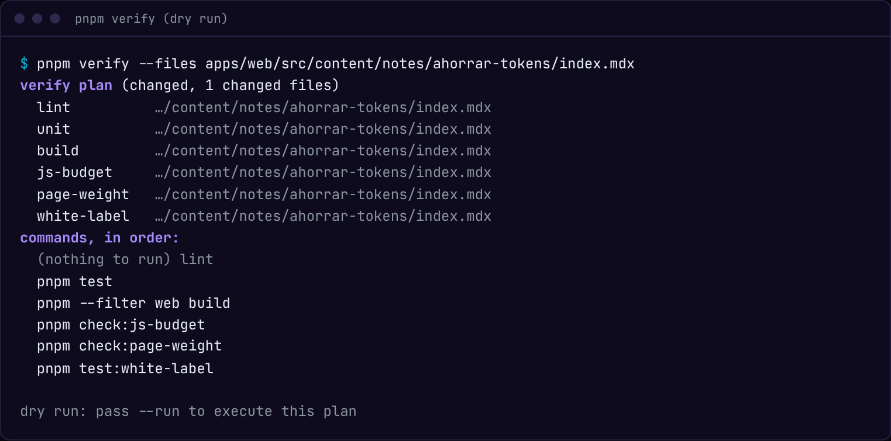
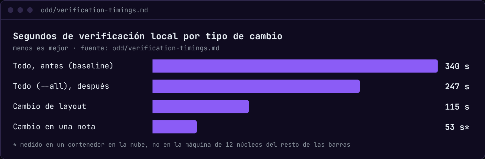

import Ink from '@/shared/ui/Ink.astro';

## 340 segundos para revisar un cambio de una línea

El 5 de octubre medí cuánto tardaba verificar este sitio en local, con todo: 340 segundos. Lighthouse se llevaba 198 (seis URLs, tres corridas cada una). Las pruebas e2e, 97 entre las tres anchuras de pantalla. Arrancar el servidor de desarrollo en frío, otros 25. Typecheck, lint, tests unitarios, build y presupuestos se repartían el resto.

El número no era lo peor. Lo peor era que lo pagaba por cualquier cosa: cambiar una coma en una nota costaba lo mismo que cambiar el footer. Ese día dejé escrito en el archivo de tiempos del repo que verificar era el mayor cuello de botella del desarrollo.

## Por qué no corro todo, y por qué no le dejo todo al CI

Había dos salidas fáciles, y descarté las dos.

- **Correr todo siempre.** Es lo más seguro, y son casi seis minutos por cambio. Un paso que cuesta eso invita a saltárselo "solo esta vez", y ahí la palabra "verificado" deja de significar algo.
- **Dejarle todo al CI.** El CI de `main` corre la batería completa antes de desplegar. Pero en mi flujo un push a `main` es un release, y un gate rojo bloquea el deploy, no el commit. Enterarme en el CI es enterarme tarde, con el commit roto ya en el historial de `main`.

Me quedé con lo de en medio: en local corro lo que el cambio toca, y el CI sigue siendo la red que lo corre todo.

## Tres tamaños de cambio

La regla vive en `CLAUDE.md` y la ejecuta un comando, `pnpm verify`. Lee qué archivos cambiaron y los clasifica:

```txt title="cómo decide pnpm verify qué correr"
¿qué archivos cambiaron?
   │
   ├─ dependencias, toolchain, config, los scripts de verificación
   │     → full-wide: todo, una vez (unos 247 s)
   │
   ├─ CSS global, tokens, shared/layout/**, i18n
   │     → layout-wide: estáticos, build, cada e2e a 1280 px
   │       y Lighthouse en 2 URLs con 1 corrida (unos 115 s)
   │
   └─ cualquier otra cosa
         → solo las comprobaciones cuyo alcance incluye esos archivos
```

Cada comprobación declara los archivos de los que depende en un solo mapa, `verification-map.ts`. Así se ve el plan para un cambio que solo toca una nota:



Lo que no está dice tanto como lo que está. No hay typecheck, porque una nota no tiene TypeScript. No hay e2e ni Lighthouse, porque esas pruebas miden páginas de prueba aisladas, no mis notas reales. Y lint sale como "nothing to run": Biome no lee Markdown.

Al preparar esta nota corrí ese mismo plan con `--run`. Ojo: fue en un contenedor en la nube, no en la máquina de 12 núcleos donde medí los 340 s, así que tómalo como orden de magnitud.


Ningún umbral bajó. Lighthouse en local corre una vez por URL en vez de tres, pero el CI y `pnpm test:lighthouse` siguen con tres corridas y los mismos límites. Lo que bajó es cuántas veces pago por medir.



## La red también tenía que ser rápida

Si el CI es la red, que tarde casi seis minutos también duele. El 5 de octubre partí las e2e en tres shards, y el 6 pasé a cuatro y partí Lighthouse en dos. Cada shard de Lighthouse sigue corriendo tres veces cada URL y con las mismas aserciones.


El job más lento pasó de 265 s a 173 s, y el release completo, de unos 328 s a 221 s.

## Una huella por comprobación

`pnpm verify --stale` no le cree al historial de commits: le cree a los archivos. Cada comprobación guarda un hash de la ruta y el contenido de todo su alcance, y solo se vuelve a correr si algún byte cambió desde la última vez que pasó. Antes de un release corro eso y nada más.

Lo que no se corre queda anotado como "not re-run: untouched since `<sha>`", nunca como verificado. Esa parte, la de no poder exagerar, la conté en [la nota sobre la documentación que se queda atrás](/notes/cuando-la-documentacion-se-queda-atras/).

## Lo que se rompió

**El grafo de imports no ve las pruebas de navegador.** Parece la respuesta obvia: si cambio un archivo, corro los tests que lo importan. Pero `codegraph affected` no devolvió nada para `global.css` ni para `ContactForm.tsx`, y `contact.spec.ts` ejercita los dos. La prueba carga una página; no importa nada. Por eso el mapa es una lista de globs escrita a mano, y por eso tiene tests propios: cada spec debe estar mapeado, cada URL de Lighthouse debe existir y ningún alcance puede quedar vacío.

**Una huella que no veía el toolchain.** Los archivos de toolchain no entraban en la huella de cada comprobación, así que `--stale` podía decir que todo estaba fresco después de un cambio de configuración, y un cambio full-wide quedaba escondido. Lo arreglé en `e3dedd6`. La primera corrida después tuvo que rehacer el registro completo: 272 s, 48 comprobaciones.

Ese es el fallo que más me preocupa de una herramienta así: no que corra de más, sino que diga "no hay nada que correr" cuando sí lo hay.

## Lo que me cuesta

- **Mantener el mapa.** Un spec o una página nueva significa tocar `verification-map.ts`. Los tests me avisan si lo olvido, pero el trabajo sigue siendo mío.
- **El footer sigue siendo caro.** La mayoría de las e2e están mapeadas a todas las páginas, así que un cambio en el footer selecciona los 41 specs. Afinarlo exige revisar qué renderiza cada página.
- **La red a veces atrapa.** El 11 de octubre, el registro decía que las e2e a 390 y 768 px no se habían corrido en local, y el CI falló justo ahí. El deploy no salió, pero el commit ya estaba en `main`.

## Si te pasa lo mismo

No necesitas mi script. Lo que sí necesitas es <Ink>una lista honesta de qué comprobación depende de qué archivos, y anotar lo que no corriste</Ink>. Con eso, 340 segundos por cambio se vuelven una decisión y no una costumbre.

¿Cómo decides tú qué pruebas correr antes de hacer push? Si tu grafo de imports sí ve tus pruebas de navegador, cuéntame cómo en los comentarios.
